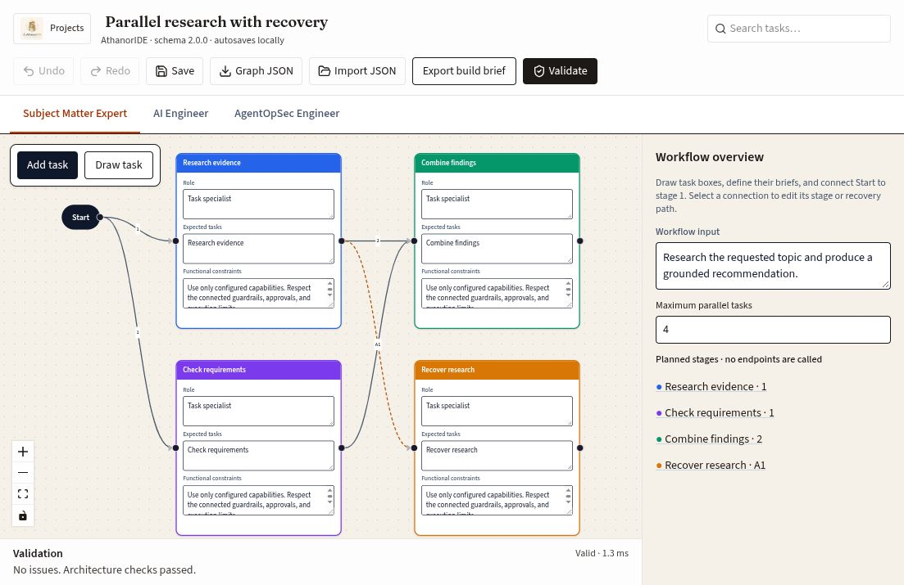
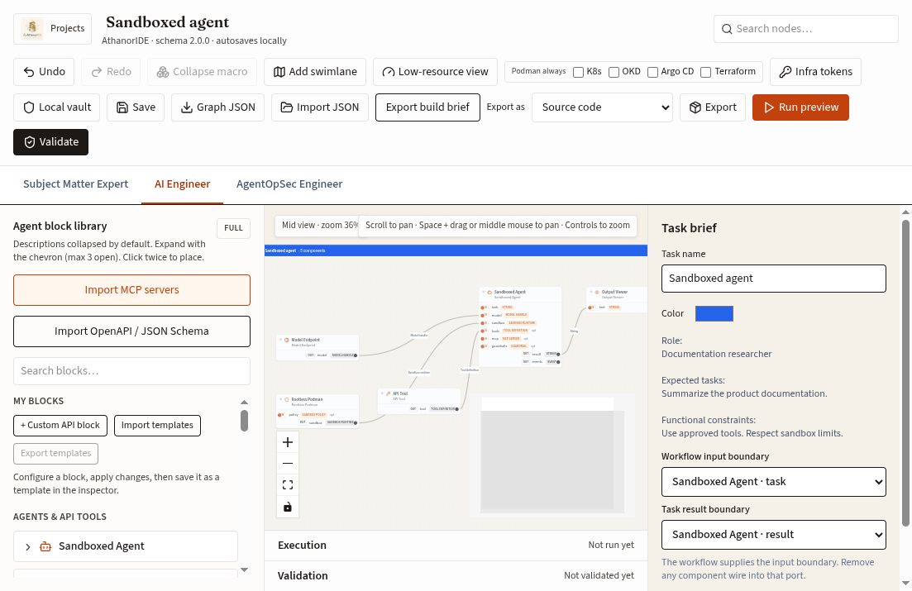
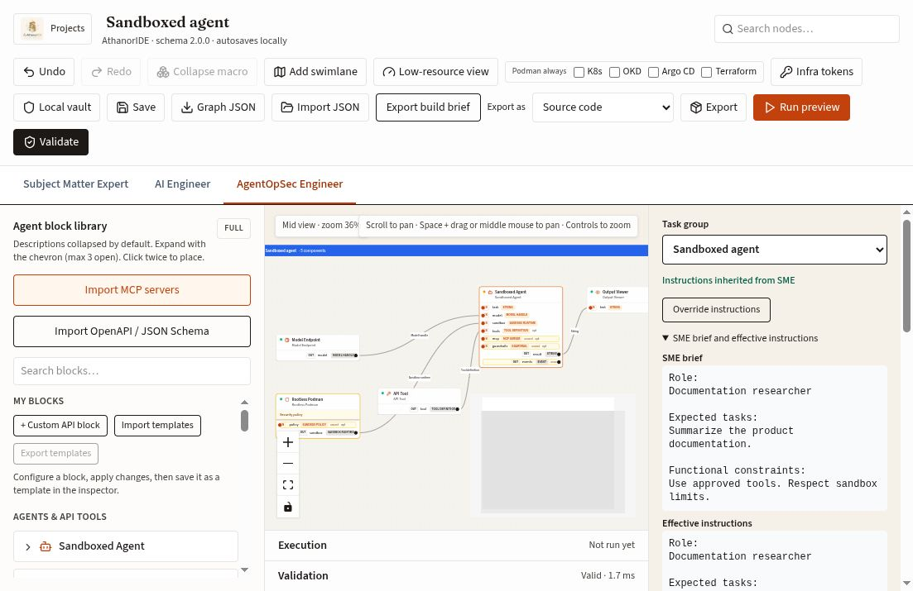
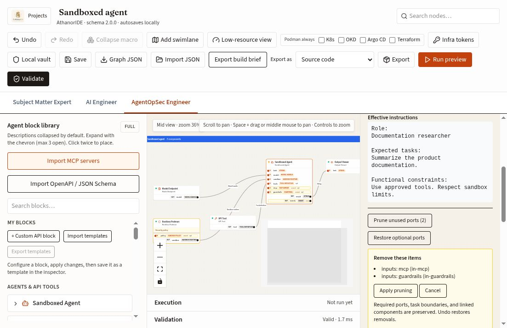

# Workspace screenshots

Actual browser captures of AthanorIDE's schema-2.0.0 workspace. The SME image uses **Parallel workflow + recovery**; the engineering and security images use **Sandboxed agent** with a short documentation-research brief. The images contain demonstration data and show design/review state, not a live agent run.

## Subject Matter Expert

Draw and edit colored task briefs, connect numbered stages, and define recovery routes. This example has two stage-1 tasks, a stage-2 join, and an A1 handler. The overview lists the workflow input, concurrency limit, and planned stages.

See [SME controls and handoff](user-guide.md#subject-matter-expert).

## AI Engineer

The SME task appears as a colored group containing its implementation components. The task inspector carries the brief and declares the string input/result boundaries used by workflow execution.

See [component assignment, boundaries, and instruction inheritance](user-guide.md#ai-engineer).

## AgentOpSec Engineer

The engineering layout highlights security controls and unused ports. Selecting an agent exposes its task membership, inherited-instruction status, and the SME/effective-instruction comparison.

See [security review and findings](user-guide.md#agentopsec-engineer).

## Pruning preview

**Prune unused ports** lists exact optional-port removals before applying them. This preview identifies the unconnected MCP and guardrail inputs; it also explains which connections and boundaries are protected and how Undo restores removals. The screenshot was captured before applying pruning.

## Refreshing the screenshots

The SME capture was taken on October 24, 2026; the engineering, security, and pruning captures were taken on October 25, 2026. JPEG files are checked into [assets/](assets/) and render directly on repository hosts without an external image service.

To refresh them, open the named starters, select the relevant role and task or component, and capture the actual browser viewport. Keep the role tabs and surrounding editor visible, use demonstration content without credential values, and retain the filenames so README and guide links continue to work. Review the saved images for readable controls and unexpected private content before committing.
